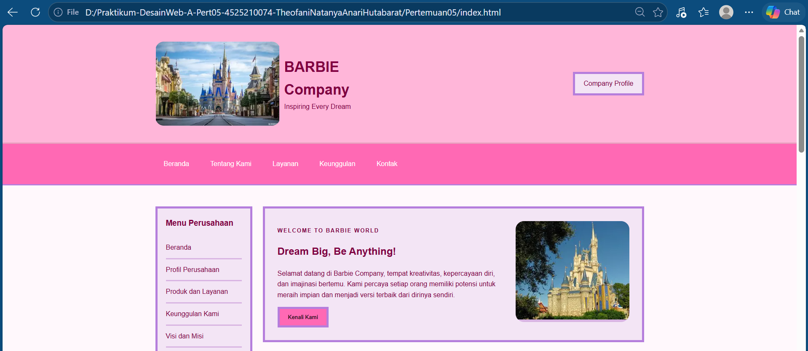
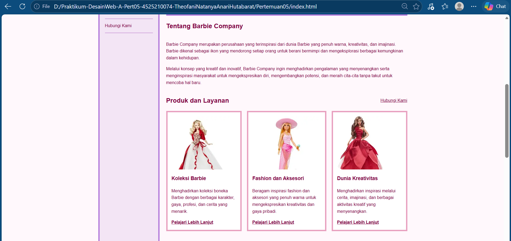
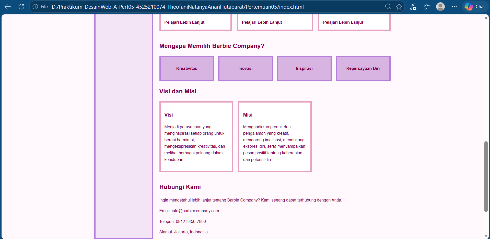
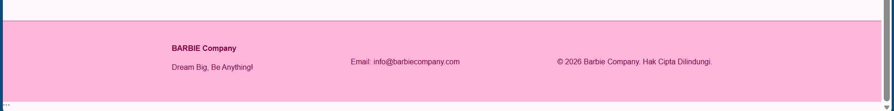

# Identitas #

- Nama: Theofani Natanya Anari Hutabarat
- NPM: 4525210074  
- Mata Kuliah: Praktikum Desain Web - A 
- Materi : Pertemuan 05
- Dosen : Ari Wibowo, S.Kom., M.Kom., C. Pro.

# Deskripsi Proyek

Proyek ini adalah pembuatan website Barbie Company menggunakan HTML dan CSS. Website dirancang sebagai halaman company profile yang menampilkan informasi mengenai produk, layanan, dan kreativitas yang berkaitan dengan Barbie. Tampilan website menggunakan kombinasi warna pink, ungu, putih, dan burgundy untuk memberikan kesan menarik dan sesuai dengan tema Barbie.

Website terdiri dari beberapa bagian utama, yaitu Header, Navigasi, Sidebar, Hero Section, Produk, Layanan, dan Footer. Dalam pengerjaannya, digunakan CSS eksternal, CSS Box Model, reusable class, CSS Grid, Flexbox, serta media query agar tampilan dapat menyesuaikan ukuran layar yang berbeda.

# Penerapan CSS

**Box Model**
CSS Box Model diterapkan melalui penggunaan:

1. Margin
2. Padding
3. Border
4. Border Radius
5. Width
6. Height
7. Box Sizing

**CSS Grid dan Flexbox**

CSS Grid digunakan untuk mengatur tata letak bagian utama website, seperti main-layout, hero, card-grid, dan layanan-grid Sementara itu, Flexbox digunakan pada bagian header, navigasi, sidebar, dan footer agar elemen dapat tersusun dengan rapi.

# Reusable Class

Reusable class yang digunakan dalam website ini antara lain:

1. container
2. header-wrapper
3. brand
4. nav-wrapper
5. main-layout
6. sidebar
7. content
8. hero
9. card-grid
10. card
11. layanan-grid
12. footer-wrapper

Class tersebut membantu mengatur tampilan elemen website agar lebih terstruktur dan mudah dikelola.

# Responsive Design

Media Query digunakan untuk menyesuaikan tampilan website pada ukuran layar tablet dan smartphone. Fitur responsive yang diterapkan:

1. Layout utama berubah menjadi satu kolom pada layar yang lebih kecil.
2. Sidebar menyesuaikan susunan elemen agar lebih fleksibel.
3. Card produk berubah dari tiga kolom menjadi dua kolom pada layar tablet.
4. Card produk berubah menjadi satu kolom pada layar smartphone.
5. Bagian layanan menyesuaikan jumlah kolom berdasarkan ukuran layar.
6. Menu navigasi ditampilkan secara vertikal pada smartphone.
7. Hero Section dan Footer menyesuaikan susunan elemen agar tetap nyaman dilihat.

# Fitur Website

1. Header yang menampilkan identitas Barbie Company.
2. Navigasi untuk memudahkan perpindahan antarbagian website.
3. Sidebar yang berisi tautan informasi.
4. Hero Section sebagai bagian utama halaman.
5. Card produk yang menampilkan gambar dan informasi produk.
6. Bagian layanan yang menampilkan beberapa kategori layanan.
7. Tombol pada Hero Section.
8. Penggunaan gambar pada bagian website.
9. CSS eksternal untuk mengatur tampilan.
10. Penggunaan CSS Grid dan Flexbox.
11. Responsive design menggunakan media query.
12. Penggunaan reusable class dan CSS Box Model.
13. Kombinasi warna pink, ungu, putih, dan burgundy yang sesuai dengan tema Barbie.

# Struktur Halaman

- Header
Menampilkan identitas atau nama Barbie Company serta informasi profil perusahaan.

- Navigasi
Menampilkan menu yang dapat digunakan pengguna untuk berpindah ke bagian website yang tersedia.

- Sidebar
Menampilkan tautan atau informasi tambahan yang mendukung navigasi website.

- Hero Section 
Menjadi bagian utama website yang menampilkan informasi pengenalan, teks promosi, gambar, dan tombol.

- Produk
Menampilkan tiga card yang berisi gambar, judul, deskripsi, dan tautan informasi lebih lanjut mengenai produk atau kategori yang ditawarkan.

- Layanan
Menampilkan beberapa kategori layanan dalam bentuk kotak yang disusun menggunakan CSS Grid.

- Footer
Menampilkan bagian penutup website dengan informasi tambahan mengenai perusahaan.

# Hasil Tampilan

BERANDA ( HEADER )

TENTANG BARBIE COMPANY & PRODUK SERTA LAYANAN

KEUNGGULAN & KONTAK

KONTAK ( FOOTER )

# Kesimpulan

Website Barbie Company berhasil dibuat menggunakan HTML dan CSS dengan tujuan menampilkan informasi perusahaan, produk, dan layanan dalam tampilan yang menarik dan terstruktur. Penggunaan kombinasi warna pink, ungu, putih, dan burgundy memberikan identitas visual yang sesuai dengan tema Barbie.

Penerapan CSS Box Model membantu mengatur jarak dan ukuran elemen, sedangkan CSS Grid dan Flexbox mempermudah penyusunan tata letak website. Selain itu, penggunaan reusable class membuat kode CSS lebih terorganisasi. Media Query pada ukuran layar 900px dan 600px juga membantu menyesuaikan tampilan website pada perangkat tablet dan smartphone. Melalui proyek ini, pemahaman mengenai pengaturan layout, penggunaan CSS, dan penerapan responsive web design menjadi semakin baik.